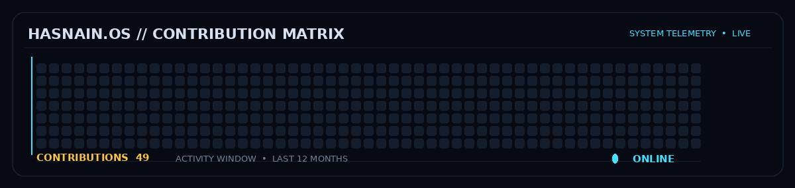

<p align="center">
  
</p>

<p align="center"><b>CSE AI/ML Student</b> &nbsp;•&nbsp; <b>AI & Software Engineering Learner</b></p>
<p align="center"><i>Artificial Intelligence • Agentic Systems • Web Applications • Building in Public</i></p>
<p align="center"><a href="https://github.com/hasnain1522">GitHub</a> &nbsp;•&nbsp; <a href="https://www.linkedin.com/in/mohammed-hasnain78931522/">LinkedIn</a> &nbsp;•&nbsp; <a href="https://hasnainos.onrender.com">Portfolio</a></p>

---

## ◈ IDENTITY CORE

I'm **Mohammed Hasnain**, a **B.Tech CSE (AI/ML) student** learning by turning ideas into working software.

My current learning and building areas include:
- 🤖 Artificial Intelligence and Machine Learning
- 🧠 Agentic AI, tools and multi-agent workflows
- 🌐 Web development and interactive applications
- 🐍 Python and backend engineering
- 🗄️ APIs, databases and software architecture
- ⚡ Hackathons, prototyping and collaborative development

> **Learn → Build → Test → Debug → Document → Improve → Repeat**

I want this profile to reflect what I have actually built, what worked, what did not, and what I learned along the way.

---

## ◈ CURRENT OPERATIONS

| Area | Focus | Status |
|---|---|---|
| CSE AI/ML | Academic foundations and practical learning | 🟢 Active |
| Agentic AI | Agents, tools, research and AI applications | 🟢 Exploring |
| Web & Backend | React, APIs, Python and application workflows | 🟢 Building |
| Hasnain.OS | Personal portfolio and digital archive | 🟡 In development |
| CareerGuide AI | AI-guided career platform prototype | 🟢 Evolving |
| Easy Ride | Mobility and delivery platform concept | 🔒 Planned |

---

## ◈ FEATURED PROJECTS

### ◆ DevForge — Python Repository Analysis & Improvement

**Connect Repository → Analyse → Review Findings → Choose Work → Apply Changes → Verify**

DevForge explores how AI can help developers inspect large Python codebases, surface potential issues and improvement opportunities, explain findings, and turn selected work into scoped tasks. The developer stays in control and decides whether to proceed with AI-assisted changes.

**Built for:** IBM Bob 2.0 Hackathon (online)  
**Outcome:** The project did not progress as a selected hackathon entry. The end-to-end live provider workflow was not fully validated before the deadline, so it is documented as an engineering prototype—not a completed competition submission.

→ [View DevForge](https://github.com/hasnain1522/DevForge)

### ◆ RFPulse — AI RFP Intelligence

**Read RFP → Recall Experience → Recommend → Draft → Record Outcome → Learn**

An AI-powered RFP intelligence prototype built for **Devnovate × Hack With India — Hack With Hyderabad 3.0**. It explores a memory-driven proposal workflow: understanding requirements, recalling relevant previous outcomes, identifying gaps, recommending an approach and drafting responses.

**Round:** Online team-selection round  
**Outcome:** The team was not selected for the offline final at Microsoft Office, Hyderabad.

→ [View RFPulse](https://github.com/hasnain1522/RFPulse)

### ◆ StockSense — Inventory Management System

A team-built inventory management prototype developed for the **Odoo × GCET Hyderabad Hackathon 2026**, where the challenge was to build an Inventory Management System.

The standalone application explores products, warehouses, locations, receipts, deliveries, transfers, adjustments, movement history and dashboard metrics. It uses a React/Vite frontend with an Express and SQLite backend; it is not an Odoo-integrated deployment.

**Round:** Online round completed on 26 September 2026  
**Outcome:** The team was not selected for the offline final.

→ [View StockSense](https://github.com/hasnain1522/stocksense)

### ◆ CareerGuide AI — AI Career Companion

An evolving AI platform prototype exploring career guidance, personalized learning plans, roadmaps, missions and progress tracking. The broader direction is to connect students, educational institutions and companies through useful AI-assisted workflows.

→ [View AI-Career-Agent](https://github.com/hasnain1522/AI-Career-Agent)

### ◆ Hasnain.OS — Personal Command Center

A personal portfolio designed as an interactive operating-system-style experience rather than a conventional static portfolio.

**Boot → Identity → Command Center → Projects → Tech Core → Experience → AI Lab → Future Builds**

→ [View Hasnain.OS](https://github.com/hasnain1522/HasnainOS) · [Open portfolio](https://hasnainos.onrender.com)

---

## ◈ PROJECT MATRIX

### 🤖 AI & Agentic Systems
- [CareerGuide AI / AI-Career-Agent](https://github.com/hasnain1522/AI-Career-Agent) — AI-guided career companion and platform prototype.
- [DevForge](https://github.com/hasnain1522/DevForge) — Python repository analysis and user-controlled AI-assisted improvements.
- [RFPulse](https://github.com/hasnain1522/RFPulse) — RFP intelligence and proposal-memory workflow.

### 🌐 Web & Product Engineering
- [Hasnain.OS](https://github.com/hasnain1522/HasnainOS) — Interactive personal portfolio.
- [StockSense](https://github.com/hasnain1522/stocksense) — Standalone inventory management prototype.
- [Easy Ride](https://github.com/hasnain1522/EasyRide) — Planned mobility and delivery platform concept.
- [Way Down We Go](https://github.com/hasnain1522/-Way-Down-We-Go-HTML-Practice-Project) — Early HTML practice webpage with text, links, images, audio and video.

### 🐍 Python Foundations
- [Simple Bank Chatbot](https://github.com/hasnain1522/Simple-Bank-Chatbot) — Rule-based Python chatbot built during a one-week AI/ML Bootcamp at NGCC Software Technologies, Hyderabad. It is a learning project, not an ML-powered banking system.

---

## ◈ HACKATHON EXPERIENCE

I use hackathons to practise the full product loop: **Understand the Problem → Plan → Build → Debug → Demo → Document**. Participation and outcomes are recorded honestly.

| Hackathon | Project | Recorded outcome |
|---|---|---|
| IBM Bob 2.0 | DevForge | Online build; not selected. End-to-end provider workflow remained unvalidated. |
| Odoo × GCET Hyderabad Hackathon 2026 | StockSense | Online round completed; team not selected for offline final. |
| Devnovate × Hack With India — Hack With Hyderabad 3.0 | RFPulse | Online team-selection round; team not selected for offline final. |

---

## ◈ TECH CORE

<p align="center"></p>

<sub>These are technologies I am learning, exploring or have used in projects. This is not a claim of mastery.</sub>

---

## ◈ ENGINEERING INTERESTS

```text
Artificial Intelligence
        ↓
Agentic AI: Agents + Tools + Research + Memory
        ↓
APIs + Databases + Web Applications
        ↓
Useful, reliable AI-powered products
```

I'm especially interested in systems where AI can use tools, work within clear boundaries, verify outputs, preserve evidence and interact with real software workflows.

---

## ◈ BUILD PHILOSOPHY

```text
IDEA → RESEARCH → PROTOTYPE → TEST
  → DEBUG → VERIFY → DOCUMENT → IMPROVE
```

I value **working software, honest documentation and measurable progress** over simply listing technologies.

A failed experiment is useful when I can explain what I tried, what broke, why it broke and what I learned.

---

## ◈ LEARNING ENGINE

**Current direction:** `CSE AI/ML → Python → Web & Backend → Agentic AI → APIs & Databases → Product Engineering`

My goal is to move step by step from understanding individual technologies to designing and building complete systems.

---

## ◈ HASNAIN.OS TELEMETRY

<p align="center"></p>

<p align="center"></p>

<sub>Telemetry assets are maintained through GitHub Actions in this repository.</sub>

---

## ◈ ROADMAP

**NOW**
- Strengthen CSE AI/ML foundations
- Build practical Python and web applications
- Learn agentic AI patterns and tool workflows
- Improve project quality, testing and documentation

**NEXT**
- Build more reliable AI applications
- Strengthen full-stack and backend engineering
- Gain more deployment and collaboration experience
- Contribute to open-source projects

**FUTURE**
- Develop useful AI-powered products
- Explore startup and product-building opportunities
- Turn larger ideas into systems people can actually use

---

## ◈ CONNECT

<p align="center"><a href="https://github.com/hasnain1522">GitHub</a> &nbsp;•&nbsp; <a href="https://www.linkedin.com/in/mohammed-hasnain78931522/">LinkedIn</a> &nbsp;•&nbsp; <a href="https://hasnainos.onrender.com">Portfolio</a></p>

<p align="center"><sub>HASNAIN.OS // LEARNING, BUILDING AND IMPROVING</sub></p>
